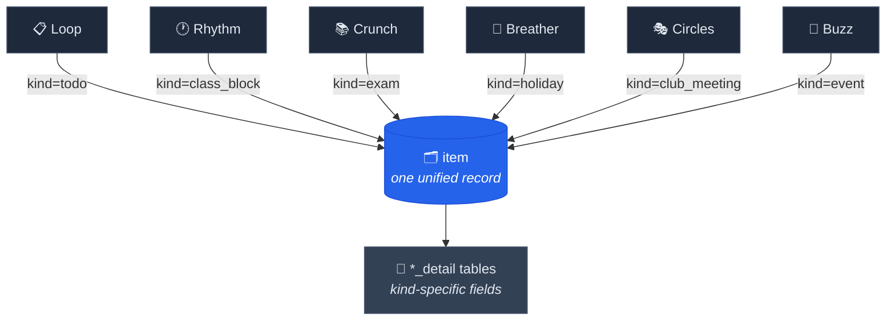
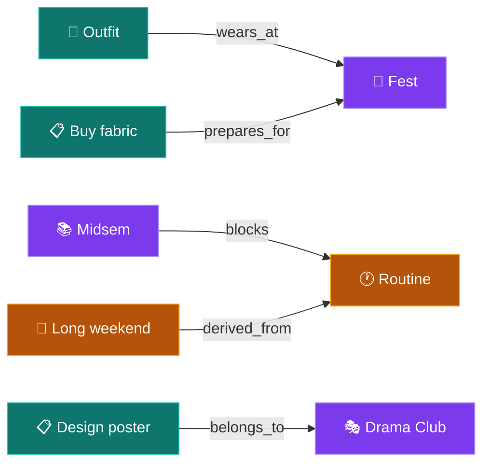
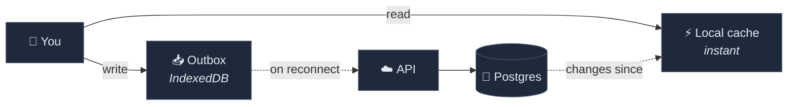
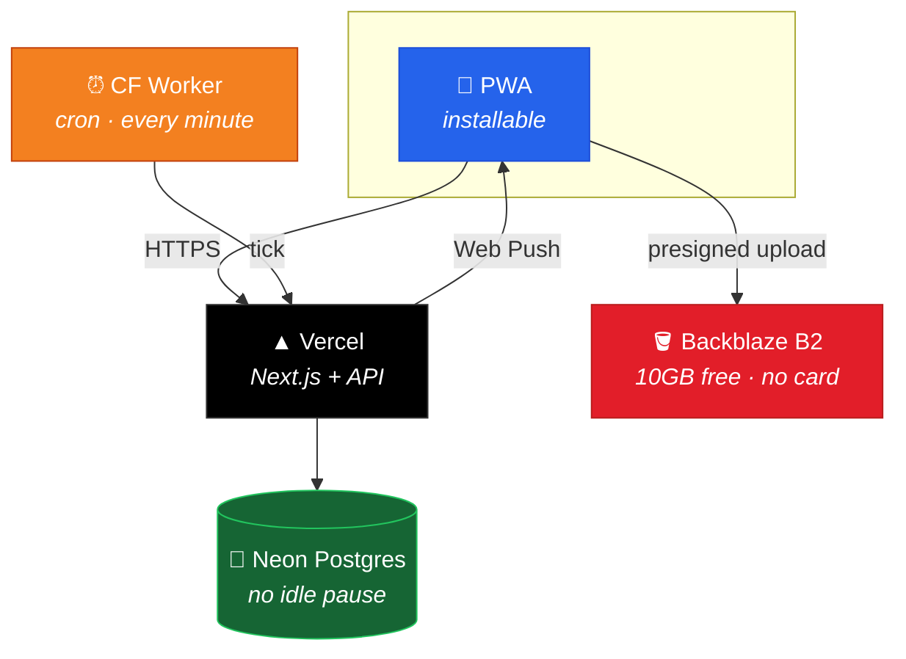

<div align="center">

# 🎓 College Ess

### Everything a student juggles — in one place.

*Your wardrobe, your routine, your deadlines, your clubs, your exams.*
*Synced everywhere. Works offline. Installs like an app.*

<br/>


<br/>

**[Architecture](#-one-idea-holds-the-whole-thing-together) · [Modules](#-twelve-modules-one-app) · [Stack](#-built-to-run-on-nothing) · [Roadmap](#-roadmap) · [Developer docs](README-dev.md)**

</div>

<br/>

---

## 💡 The problem

A student's life is scattered across eight apps that don't talk to each other.

Your exam timetable is a PDF. Your club's meeting is in a WhatsApp group. Your laundry
is a mental note you forgot. The fest you wanted to attend clashed with a lab you didn't
check. Nothing knows about anything else.

**College Ess is one app where all of it lives together — and where each piece actually
knows about the others.**

<br/>

```
      ┌──────────────────────────────────────┐
      │  9:41                       ▁▄▆ ▮▮   │
      │                                      │
      │  Good morning, Harshit               │
      │  ─────────────────────────────       │
      │                                      │
      │  ▸ TODAY · Class day                 │
      │                                      │
      │   08:30  ┃ Physics — LH3             │
      │   10:15  ┃ DSA Lab — CL2             │
      │   14:00  ┃ 🎭 Drama club meet        │
      │                                      │
      │  ▸ WEARING                           │
      │   ┌────┐ ┌────┐                      │
      │   │ 👕 │ │ 👖 │  2 wears left        │
      │   └────┘ └────┘                      │
      │                                      │
      │  ▸ UP NEXT                           │
      │   ⚠ Midsem in 6 days                 │
      │   ○ Buy notebooks                    │
      │                                      │
      │  ───────────────────────────────     │
      │   🏠     📋     👕     📅     ⚙      │
      └──────────────────────────────────────┘
```

<br/>

---

## ✨ Twelve modules, one app

<table>
<tr>
<td width="33%" valign="top">

### 📋 Loop
**Tasks that sort themselves**

Type *"Physics exam 15th"* — it becomes an exam, on the right date, in the right module.

</td>
<td width="33%" valign="top">

### 🕐 Rhythm
**A routine that knows the day**

Class day, exam day, holiday, study day — each has its own shape. It switches on its own.

</td>
<td width="33%" valign="top">

### 🔥 Groove
**Habits that stick**

Start small and build a streak. A holiday or exam day doesn't break it, and today's habits sit in your to-do list.

</td>
</tr>
<tr>
<td valign="top">

### 👕 Drip
**Your wardrobe, tracked**

Photograph your clothes, pair tops with bottoms, set wear limits, know when laundry is due.

</td>
<td valign="top">

### 📚 Crunch
**Exams you can't miss**

Seat numbers, halls, dates. Reminders you *can't* switch off — because you shouldn't.

</td>
<td valign="top">

### 🌴 Breather
**Every long weekend, early**

Three months ahead. Public holidays, college breaks, and the Fridays worth taking off.

</td>
</tr>
<tr>
<td valign="top">

### 🛒 Pantry
**Groceries before they expire**

Quantities, expiry dates, and a shopping list that writes itself.

</td>
<td valign="top">

### 🎭 Circles
**Your clubs, organised**

Meetings, roles, tasks. Coordinators get management powers automatically.

</td>
<td valign="top">

### 🎪 Buzz
**Fests, hackathons, everything**

Every campus event — with outfit planning and prep tasks attached.

</td>
</tr>
<tr>
<td valign="top">

### 🧭 Compass
**The guide, always current**

Every feature and setting explained. Readable offline. Admins will edit it right in the app, no deploy.

</td>
<td valign="top">

### 🏛️ Quad
**Campus social**

Posts, stories, and the feed — scoped to your college.

</td>
<td valign="top">

### 🪄 Sage
**AI that knows your context**

Bring your own key. It reads your schedule and helps you plan around it.

</td>
</tr>
<tr>
<td colspan="3" valign="top">

### 💬 Chat
**Encrypted, and not ours**

Messaging is delegated to a dedicated E2EE chat app. We share *by reference*, never by content.

</td>
</tr>
</table>

<br/>

---

## 🧩 One idea holds the whole thing together

Six of these modules are **structurally identical**. A todo deadline, an exam, an event,
a holiday, a class block, a club meeting — they differ by label, not by shape.

So they aren't six apps. They're six **views over one table**.



**Why it matters:** reclassifying a todo as an exam is a *single field update* — not a
migration across two tables. And *"what's happening next week?"* is one query across
every module, for free.

<br/>

### 🔗 Modules that actually talk to each other

Cross-module connections are **rows in an edge table**, not schema changes. Adding a new
one costs nothing.



> **Pick an outfit for a fest** → it appears on your timeline that morning.
> **Exams approach** → your routine switches to study mode.
> **A long weekend appears** → tasks you saved for free time surface.

<br/>

---

## 📡 Offline is not an afterthought

Campus wifi is bad. The app is built for that.



Write a todo in a dead zone. It saves instantly, queues, and lands when you're back.
The guide is cached in full — because you need help *most* when the network is worst.

<br/>

---

## 🏗️ Built to run on nothing

Every piece was chosen to fit inside a free tier — **$0 to roughly 800 users**.



| Choice | Why this one |
|:--|:--|
| 🪣 **Backblaze B2 for files** | 10 GB free with **no card needed**; downloads free up to 3× what's stored, so images are cached on the device |
| ⏰ **Cloudflare cron** | Vercel's free tier caps cron at once per **day**; reminders need minutes |
| 🐘 **Neon** | Free Postgres that doesn't pause on idle |
| 🔐 **Better Auth** | Self-hosted, TOTP built in, unlimited users, $0 forever |
| 🔔 **Web Push** | Native, no Firebase, no third party |

<br/>

---

## 🔒 Privacy, by design

<table>
<tr><td width="50%">

**🏫 Your data stays in your college**
Every record is scoped to your institution. Cross-college access is structurally
prevented, not merely discouraged.

</td><td width="50%">

**🤖 AI never sees a training tier**
Model providers that train on inputs never receive student data. Sage is bring-your-own-key.

</td></tr>
<tr><td>

**💬 Chat stays encrypted**
Messaging is end-to-end encrypted in a separate app. Content is shared **by reference** —
the recipient fetches it with *their own* permissions.

</td><td>

**📝 You choose what leaves your device**
Task auto-classification runs on-device first. The optional model fallback is off by
default, and the guide says so plainly.

</td></tr>
</table>

<br/>

---

## 🗺️ Roadmap

<table>
<tr><th align="left">Stage</th><th align="left">What lands</th><th align="center">Status</th></tr>

<tr><td><b>Foundation</b></td><td>Monorepo, schema, migrations, CI</td><td align="center">✅</td></tr>
<tr><td></td><td>Auth — email, password, TOTP 2FA, recovery codes</td><td align="center">✅</td></tr>
<tr><td></td><td>🧭 Compass — the guide, offline, generated settings docs</td><td align="center">✅</td></tr>
<tr><td></td><td>Permissions, offline sync, assets, design system, reminders, editing the guide in the app</td><td align="center">🚧</td></tr>

<tr><td><b>Phase 1</b></td><td>📋 Loop · 🕐 Rhythm — tasks, routines, recurrence, reminders</td><td align="center">📋</td></tr>
<tr><td><b>Phase 2</b></td><td>👕 Drip — wardrobe, pairing, wear tracking, laundry</td><td align="center">📋</td></tr>
<tr><td colspan="3" align="center"><i>— first public release —</i></td></tr>
<tr><td><b>Phase 3</b></td><td>🔥 Groove · 📚 Crunch · 🌴 Breather · 🛒 Pantry · a calendar link for Google, Apple and Outlook</td><td align="center">📋</td></tr>
<tr><td><b>Phase 4</b></td><td>🎭 Circles · 🎪 Buzz · admin panel</td><td align="center">📋</td></tr>
<tr><td><b>Phase 4.5</b></td><td>🔗 Google — sign in, backups to your Drive, calendar sync</td><td align="center">📋</td></tr>
<tr><td><b>Phase 5</b></td><td>🏛️ Quad — campus social</td><td align="center">📋</td></tr>
<tr><td><b>Phase 6</b></td><td>🪄 Sage — AI guidance that keeps working when you close the app</td><td align="center">📋</td></tr>
</table>

<div align="center"><sub>✅ shipped · 🚧 in progress · 📋 planned</sub></div>

<br/>

---

## 🚀 Try it locally

```bash
pnpm install
cp .env.example apps/web/.env.local
# in apps/web/.env.local, set DATABASE_URL=pglite://memory
pnpm dev
```

Open **http://localhost:3000**. No database setup needed — `pglite://memory` runs an
in-process Postgres. Every other value in the file must be present too: the server
refuses to start without them, and says which are missing.

> 🛠️ **Building on this?** [**README-dev.md**](README-dev.md) has the architecture in
> depth, the conventions that are load-bearing, an honest assessment of the current
> state, and what to be careful about. Read it before your first commit.

<br/>

---

## 🤝 Contributing

Foundation work is active, so the shape of things is still moving. A few conventions are
load-bearing and worth knowing before you open a PR:

- **Anything that accumulates is append-only** — derive totals, never store a mutable counter
- **Help text lives in the database**, not in components
- **Fail closed** — no fallback secrets, ever
- **Code with no caller isn't done**

The reasoning behind each is in [README-dev.md](README-dev.md).

Deploying, every environment variable, the architecture and how the tests work: the
[docs set](docs/README.md).

<br/>

---

<div align="center">

**Built for students, by a student.**

<sub>License not yet specified.</sub>

</div>
