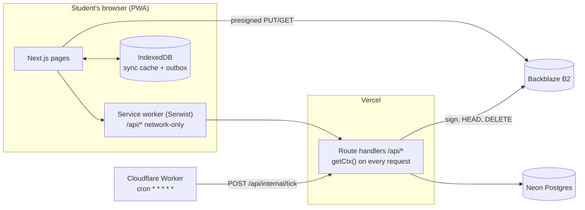
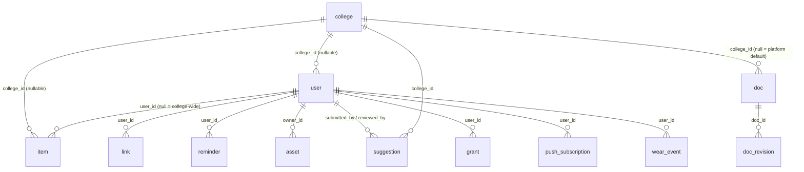
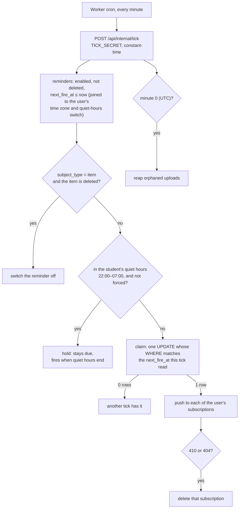

# Architecture

> **For:** developers changing the data model, a route, sync, reminders or uploads.
> **Update it when** a sub-phase changes a primitive's shape, the tenancy or permission
> model, the sync protocol, the reminder engine, the upload pipeline, or where something
> runs (RULES R22).
> **Last checked against the code:** `166536f`, 2026-10-10.

How College Ess is put together, as the code at `166536f` does it. Where the plan goes
further, the gap is marked **not built**. Deploy steps are in
[`DEPLOYMENT.md`](DEPLOYMENT.md); module status in [`APP-DETAILS.md`](APP-DETAILS.md).

## Where it runs



| Piece | Where | Why there |
|---|---|---|
| Pages and API (`apps/web`) | Vercel Hobby, one Next.js 15 App Router project | free; one deploy |
| Database | Neon Postgres, through Drizzle's `neon-http` driver | free, no idle pause. HTTP driver: single statements and `db.batch` only, **no interactive transactions** |
| Scheduler (`apps/scheduler`) | Cloudflare Worker, cron every minute | Vercel Hobby's cron runs once a day |
| Photos | Backblaze B2, S3 API | 10 GB free with no card; egress free up to 3× stored |
| Push | browsers' push services, Web Push with VAPID | no FCM dependency |
| Local, test, E2E database | PGlite in the server process (`DATABASE_URL=pglite://memory`) | real Postgres, no Docker |

Packages: `packages/core` (domain types, `can()`, settings registry, sync types; also
bundled into the browser, so no `process.env`, no `node:`, no DB) and `packages/db`
(server only: schema, `createDbClient`, `scopedDb`, `onRoleChange`, `requireEnv`, seed).

## The central idea: six primitives

Six of the planned modules are the same shape, a dated record with a category. Rather than
ten apps with N² integrations, everything rests on six shared tables. Every table carries
the **sync triple** plus `created_at`: `id` (UUID v7, sortable and client-generatable),
`updated_at`, `deleted_at` (soft delete), via `syncTriple()` in
`packages/db/src/schema/helpers.ts`. Only Better Auth's `session`, `account`,
`verification` and `two_factor` lack `deleted_at` (R3.1).



| Primitive | Table | What it is | Today |
|---|---|---|---|
| **item** | `item` | the unified dated record: `kind` (`todo`, `event`, `exam`, `holiday`, `class_block`, `club_meeting`, `outfit_plan`, `restock`), `title`, `starts_at`/`ends_at`, `rrule`, `all_day`, `status`, `priority`, `source`. A module is a view over `kind`; kind-specific fields go in companion `<kind>_detail` tables | table and sync policy built; no `_detail` table, no screen, no recurrence expansion |
| **link** | `link` | typed edges between any two rows: `from_type/from_id → to_type/to_id`, `relation` (`prepares_for`, `wears_at`, `belongs_to`, `blocks`, `derived_from`, `attended`). Every cross-module integration is a row here, never a foreign key between modules (R1). Owned: `user_id NOT NULL` | built, unused |
| **reminder** | `reminder` (+ `push_subscription`) | one notification engine for every module ([below](#the-reminder-engine)) | built; push channel only |
| **asset** | `asset` | one upload pipeline for every file ([below](#the-asset-pipeline)) | built; the profile photo uses it |
| **suggestion** | `suggestion` | one moderation queue for changes to college data: `target_type`, `target_id`, `proposed_diff`, `status` (`pending`, `approved`, `rejected`), `reviewed_by`, `review_note` | built in sync; no screen |
| **doc** | `doc` (+ `doc_revision`) | Compass pages: `slug`, `audience`, `kind` (`guide`, `faq`, `changelog`), `body_md`, `order_index`, `min_role`, `published`; a college's row overrides the platform default (`college_id` null) with the same slug | built |

Two domains deliberately **don't** use `item`: Drip's wardrobe (an inventory, its own
tables in Phase 2; it writes `outfit_plan` items to reach the timeline) and Quad's feed (a
graph and ranking problem, Phase 5).

**Anything that accumulates is append-only** (R2): wear counts, streaks and attendance are
event rows and the total is derived, because last-write-wins sync can't merge counters.
`wear_event` is the first such table; `APPEND_ONLY_TABLES` in `packages/core/src/sync.ts`
lists them.

## Tenancy

The schema is multi-tenant from day one; one college is seeded and run.

- **`college_id`** on every shared row. Null means platform-wide (a platform guide page) or,
  on `item`, with `user_id` set, purely personal.
- **`scopedDb(ctx, client)`** (`packages/db/src/scoped.ts`) is the guarded read. On the
  table passed to `from()` it injects `deleted_at IS NULL` (unless tombstones are asked for)
  and `college_id = <caller's college> OR college_id IS NULL` (a collegeless caller sees
  only `college_id IS NULL`). A caller's own `where` is added to the guard, never instead of
  it. It exposes only `select` and `selectDistinct`; joined tables are not guarded.
- **The caller's college comes from the server**, never the request: `user.college_id` is a
  Better Auth field with `input: false`, so sign-up and profile updates can't set it.
  *Not built:* anything that sets it in production (0.5-6). Today every real user is
  collegeless.
- Proven at the HTTP boundary: a student of college A requesting college B's rows gets
  nothing (`tests/sync-authz.test.ts`, the harness's `seedTwoColleges()`).

## Scoped permissions

```
role       student | co_admin | college_admin | platform_admin     (user.role)
grant      user_id, permission "verb:resource", scope_type, scope_id, granted_by, expires_at
scope_type platform | college | club
```

- **`role` says who you are** (it picks the guide's audience) and authorises nothing on its
  own. **Authority is a `grant` row** with a scope, never a boolean column (R5).
- **`getCtx()`** (`apps/web/src/lib/ctx.ts`) builds every request's context once: user,
  college and role from the session, active grants (not soft-deleted, not expired) from the
  database. `userMode` (an admin viewing as a student) has no storage yet and is always
  `false` (Phase 4).
- **`can(ctx, permission, scope)`** (`packages/core/src/permissions.ts`) never throws and
  fails closed. A platform admin with a platform grant passes everything; otherwise a grant
  matches on permission (or `*`) and scope; a college-scoped grant covers that college's
  clubs once a club can be resolved to its college (a placeholder until Phase 4).
- **`onRoleChange(db, event)`** issues the grants a role implies (`computeGrantsForRole`):
  `platform_admin` → `*` on the platform; `college_admin` → `manage:college` on the
  college; `co_admin` → `manage:club` on the scope. Becoming `student` soft-deletes them.
  *Not built:* any production caller. Only the test harness calls it until 0.5-7 §1's
  admin command.
- **Where `can()` runs today:** `/api/sync`, where `manage:college` lets a college admin
  change the college's shared items and moderate its suggestions. Students get 403.

## The sync model

Server-authoritative, with a local read cache and queued writes. Not offline-first
collaborative editing, and no CRDTs.

```mermaid
sequenceDiagram
  participant P as Phone (TanStack Query + IndexedDB)
  participant O as Outbox (Dexie)
  participant S as /api/sync
  P->>S: GET ?since=<last serverTime>
  S-->>P: { serverTime, data, tombstones, full }
  Note over P: merge rows, drop tombstones,<br/>keep serverTime as the watermark
  O->>S: POST { entries: [≤50, in order] }
  S-->>O: { applied, rejected[{id,error,code}] }
  Note over S: stops at the first 5xx;<br/>later entries are not attempted
```

**Pull** (`GET /api/sync`, client `lib/sync/pull.ts`):
- One TanStack query, key `["sync"]`, holds every syncable table's rows and the watermark
  together, persisted to IndexedDB and never expired. It refetches on load, refocus,
  reconnect and after every outbox drain.
- The watermark is the server's `serverTime`, never the device clock. The server re-sends
  the minute before `since` (`PULL_OVERLAP_MS`), because a write can commit after a pull
  read past it.
- Soft-deleted rows come back as **tombstones**, so every device purges them.
- A watermark older than 7 days (`DELETED_ASSET_GRACE_MS`, after which the reaper
  hard-deletes asset rows and leaves no tombstone) gets `full: true`, and the device
  replaces its copy instead of merging.
- The cache records its owner (user and college); another account, or a new college,
  starts a full pull, and a definite sign-out drops it (being offline is not a sign-out).
- *Not built:* pagination. A first pull returns every row the account can read.

**Push** (`POST /api/sync`, client `lib/sync/outbox.ts`, `replay.ts`, `runner.ts`):
- Every write is an outbox entry with its owner (`ownerId`). Only the signed-in owner's
  entries are sent; the server refuses anyone else's with 409.
- Entries go in order, up to 50 per request. The server stops at the first fault of its
  own (5xx) and leaves the rest unattempted, so an edit never lands before its insert.
- A server fault costs the head entry one attempt (10, then it is shown as failed, with
  Retry); being offline or signed out costs nothing. Retries back off from 2 s to a minute.
- **Online means College Ess answered.** A campus Wi-Fi login page is offline, whatever the
  browser says.
- *Not built:* any screen that queues a write (`queueWrite` has no production caller until
  Phase 1-1).

**Authorisation per table** (`apps/web/src/app/api/sync/policy.ts`). Each syncable table
declares which rows you may read, which columns you may insert, and which you may change.
Every other column is server-owned and ignored, including owners, college and timestamps.

| Table | Read | Insert | Change |
|---|---|---|---|
| `item` | yours, plus your college's shared rows (`user_id` null) | `kind`, `title`, times, `rrule`, `all_day`, `status`, `priority` | yours; shared rows with `manage:college` |
| `wear_event` | yours | `garment_id`, `worn_on`, `logged_at` | never (append-only) |
| `reminder` | yours | subject, trigger, channel, `enabled`, `next_fire_at` (not `forced`) | yours, same columns |
| `link` | yours | the edge and relation | yours |
| `asset` | yours | **never** (only `/api/assets/presign` creates assets) | delete only |
| `suggestion` | yours; the whole college queue with `manage:college` | target and diff, if you have a college | yours while pending; `status` and `review_note` with `manage:college` |

A row you can see but may not change is a 403; a row you can't see is a silent no-op, so a
403 never confirms that another college's row exists. Conflicts: the server stamps
`updated_at` on every write it accepts and ignores the client's, so the write that **reaches
the server last** wins. `doc` and `grant` never sync: the guide has its own route
(`/api/compass`, cached on the device), and authority is never cached.

**The service worker never answers `/api/` from its cache** (`apps/web/src/sw.ts`,
`NetworkOnly` for every same-origin `/api/` request): keyed by URL alone, a cache could
hand one account another's data.

## The reminder engine

One table, one scheduler, for every module (R1). No module writes its own timer.



- **Triggers:** `absolute` and `relative` fire once and switch off; `recurring` understands
  `daily@HH:MM` (wall-clock time in the student's time zone, holding across DST) and a
  millisecond interval. A late tick fires a recurring reminder once, keeps its anchor and
  logs the occurrences it skipped. `geofence` is declared, not implemented.
- **Channels:** `push` only. `inapp` and `email` are declared; the tick sends push whatever
  the channel.
- **Claim before send.** Overlapping ticks can't send twice: the claim is a compare-and-set
  in a single `UPDATE`, because `neon-http` can't hold a lock across two statements.
- **Forced reminders** (exams) ignore quiet hours. *Not enforced:* sync lets a student
  switch one off (Crunch, Phase 3).
- **Time is the student's own:** `user.timezone` (IANA, from the device at sign-up) and
  `user.quiet_hours_enabled`; quiet hours are the fixed `QUIET_HOURS` in `packages/core`.
- **Subscriptions:** `POST /api/reminders/subscribe` stores one per browser (endpoint unique);
  a subscription another account holds answers 409, and the client makes a fresh one.
- The tick answers `{ success, processedCount, deliveredCount, suppressedQuietHoursCount, … ,
  reaped }`. A failure in the reaper fails the tick (500), where the logs show it.

## The asset pipeline

One path for every file (R1).

```mermaid
sequenceDiagram
  participant B as Browser
  participant A as App (/api/assets)
  participant S as B2 bucket
  B->>B: compress to WebP on the device
  B->>A: POST /presign { mime, bytes, purpose }
  A->>A: type allowed? size ≤ purpose cap? quota ≤ 50 MB?
  A->>A: key = users/<user>/<purpose>/<uuidv7>.<ext>; row "pending"
  A-->>B: { assetId, uploadUrl } (presigned PUT, signs content-length)
  B->>S: PUT the bytes
  B->>A: POST /<id>/complete
  A->>S: HEAD the object
  A-->>B: size recorded; larger than declared → object deleted, 400
```

- **The server derives every key** (`deriveBucketKey`); a client never chooses one, which
  is what makes the ownership check meaningful. Only `/presign` creates asset rows.
- **Caps:** `profile_photo` 1 MB, `garment_photo` 2 MB, `attachment` and default 5 MB;
  50 MB per student. Types: JPEG, PNG, WebP, GIF, AVIF, PDF.
- **`/complete` trusts storage, not the client**: it records the size the HEAD reports. A 404
  means "not uploaded"; any other storage error is a 500, never "missing".
- **Presigned URLs carry no checksum** (`requestChecksumCalculation: "WHEN_REQUIRED"` in
  `lib/assets/storage.ts`): the SDK's default signs an empty body's CRC32 into every PUT, so
  every real upload would fail.
- **The signed `content-length`** makes storage refuse a PUT of any other size. **On a real
  B2 bucket the upload fails** ("header 'content-length' is listed in signed headers, but is
  not present"); which request lacked it, and the fix, are 0.5-7 §2.
- **Viewing:** `GET /api/assets/:id` returns a fresh presigned GET for the owner. *Not
  built:* caching images on the device, so every view is new egress (Phase 2).
- **Nothing writes `variants`** (thumbnails) yet; `/complete` ignores a client's. Drip's
  grid is their first consumer.
- **The reaper** (`lib/assets/reaper.ts`, from the tick at minute 0 UTC): rows still
  `pending` after 24 h are soft-deleted; soft-deleted rows past 7 days are hard-deleted with
  their objects. A completed upload nothing points at is never reaped, so code that replaces
  a photo deletes the old asset itself (the profile photo does).
- **On B2 a delete only hides an object**, and hidden objects count toward the 10 GB. The
  bucket's lifecycle rule ([DEPLOYMENT step 4](DEPLOYMENT.md#4-backblaze-b2-bucket-key-cors-lifecycle-caps--alerts))
  frees them a day later.

## Configuration and startup

Fail closed (R18): no fallbacks, ever. `instrumentation.ts` asserts the twelve required
variables when a server starts and exits naming every missing one; it then seeds an
in-memory PGlite (dev and E2E). No module has side effects on import; CLI entry points are
separate bin files never re-exported. Reference: [`ENV.md`](ENV.md).

## Compass, the guide

`doc` rows, resolved per caller by `/api/compass` (public; `scopedDb` keeps other colleges'
rows in the database): a college's page wins over the platform default, filtered by
`published` and `min_role`. Rendered with `react-markdown` + `remark-gfm` +
`rehype-sanitize`, raw HTML off, because co-admins are only semi-trusted (R13). Cached on
the device in `localStorage` and searched there. Built-in pages are
`packages/db/seed/docs/<slug>.md` with strict frontmatter (`title`, `kind`, `audience`,
`order`, `minRole`, `published`); the seed adds, updates and removes them, records a
`default` revision for each write, and never overwrites a page an admin changed.
`/guide/settings` is generated from the settings registry.
