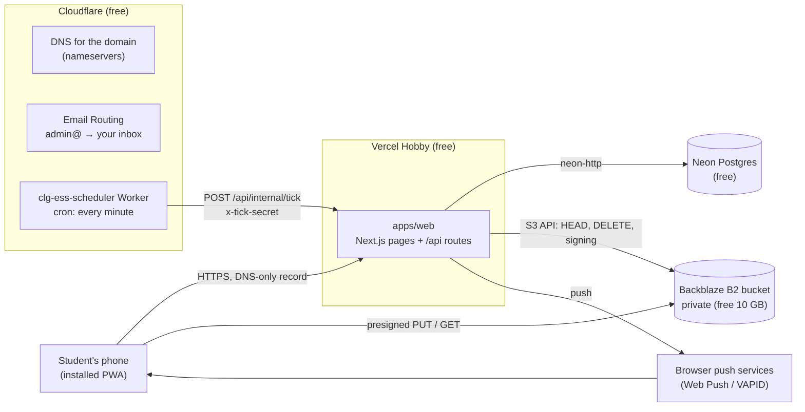

# Deploying College Ess

> **For:** whoever deploys and runs a College Ess instance.
> **Update it when** a sub-phase adds or changes a service, a secret, a migration step, a
> manual check or an operator command (RULES R22). It owns the deploy **steps**; what each
> variable means lives in [`ENV.md`](ENV.md), and other docs link here rather than copy.
> **Last checked against the code:** `166536f` (0.5-5 closed), 2026-10-10.

One ordered runbook, from nothing to a running app. Follow it top to bottom the first time;
[step 10](#10-redeploying) is what you repeat afterwards.

## Read this first: what has and hasn't been run

**No step below has been run for real end to end.** College Ess has never been deployed to
production. Every step is marked:

- **not yet run**: written from the code and the provider's current docs, never executed
  against a real account. Expect to correct details the first time through, and fix this
  file in the same commit when you do.
- **run locally**: the command was executed on a developer machine without a provider
  account (a dry run, a key generator).

Known blockers, as of `166536f`:

| Blocker | Effect on a deploy | Fixed by |
|---|---|---|
| `pnpm --filter @clg-ess/db migrate` can't reach any database: `packages/db/drizzle.config.ts` has no `dbCredentials` | Step 3 can't migrate Neon | 0.5-7 §1 (being built in parallel; not on this branch) |
| No way to make an admin | Step 8 has no command | 0.5-7 §1 (same) |
| **Uploads fail on a real B2 bucket**: B2 answers `header 'content-length' is listed in signed headers, but is not present` | The smoke test's photo upload fails | 0.5-7 §2 (open: waits on a diagnosis) |
| No email is sent; nothing places a student in a college | Every account is collegeless and sees only platform-wide rows; sign-up is open to anyone who can reach the URL | 0.5-6 (brings Brevo) |

So today you can stand up the infrastructure and check most of it. Don't invite students
until 0.5-6 and 0.5-7 have landed.

## What you are building



The app is one Next.js project (`apps/web`) that serves both the pages and the API. The
Worker (`apps/scheduler`) holds no logic: once a minute it calls the app's tick route, which
sends due reminders and, at minute 0 of each UTC hour, reaps abandoned uploads.
[`ARCHITECTURE.md`](ARCHITECTURE.md) explains the parts.

Throughout, the public URL is **`https://clg-ess.qd.je`** (the project's domain). Substitute
yours if it differs.

---

## 0. On your machine

You run migrations, the seed, the admin command and the Worker deploy from a clone.

| Tool | Version | Why |
|---|---|---|
| Node | 24 (`.nvmrc`; `engines` asks ≥24) | everything |
| pnpm | 11.9.0 (`packageManager` in `package.json`) | the workspace |
| uv | any recent | runs the Backblaze CLI with `uvx b2` (step 4) |
| A password manager | — | the secrets in step 5 have no other home |

```bash
git clone https://github.com/HasNetwork/College-ESS.git
cd College-ESS
pnpm install --frozen-lockfile
pnpm build   # builds packages/core and packages/db, which the CLI commands import from dist/
```

`pnpm build` needs `DATABASE_URL`, `BETTER_AUTH_SECRET` and `BETTER_AUTH_URL` in the shell,
because `next build` imports the auth module ([`ENV.md`](ENV.md#when-each-variable-is-read)).
For this local build, CI's non-secret values are fine:
`DATABASE_URL=pglite://memory BETTER_AUTH_SECRET=ci-only-value-not-a-secret-0123456789abcdef BETTER_AUTH_URL=http://localhost:3000`.

---

## 1. Accounts

**Not yet run.** All free; none needs a payment card except where noted.

| Account | For | Notes |
|---|---|---|
| GitHub | the repository Vercel deploys from | Vercel needs read access to it |
| Vercel (Hobby) | `apps/web` | Hobby is non-commercial only: the day anything charges money (a paid Sage tier), move to Pro (PLAN §4.2) |
| Neon (Free) | Postgres | |
| Backblaze B2 | photo storage | no card needed; at a free limit B2 alerts, then blocks requests; it never bills (the user checked the account's Caps & Alerts page, 2026-09-25) |
| Cloudflare (Free) | DNS, Email Routing, the scheduler Worker | |
| Brevo (Free) | verification email, **from 0.5-6** | not needed yet; listed so step 2's SPF record has room for it |

Use one shared operator mailbox for all of them if you can, so alerts don't land in a
personal inbox nobody reads.

---

## 2. Domain and DNS

**Not yet run.** The domain `clg-ess.qd.je` is registered with DigitalPlat. Its DNS moves to
Cloudflare so that Email Routing can give `VAPID_SUBJECT` a real mailbox.

1. **Add the domain to Cloudflare** (Free plan, full setup). Cloudflare shows two
   nameservers. At DigitalPlat, replace the domain's nameservers with those two. The domain
   becomes **Active** in Cloudflare once the change is seen (Cloudflare, "Full setup" and
   "Update nameservers").
2. **Point the domain at Vercel** (after step 6 creates the project). In Vercel, Project →
   Settings → Domains → add `clg-ess.qd.je`. Vercel then shows the exact record it wants:
   for a subdomain it gives a **project-specific CNAME** (a value like
   `<id>.vercel-dns-017.com`, not the older shared `cname.vercel-dns.com`). Create exactly
   the record Vercel shows, in Cloudflare → DNS → Records.
3. **Set that record's proxy status to DNS only (grey cloud).** This is not optional:
   - Proxied ("orange cloud"), Cloudflare sits in front of Vercel. Vercel then sees
     Cloudflare's address as every visitor's IP, and Better Auth's sign-in rate limit
     (3 attempts per 10 s per IP) becomes one bucket shared by the whole college
     (PLAN §9.4).
   - Cloudflare's own docs warn that proxying a CNAME that points at another CDN causes
     TLS failures and routing loops.
4. **Email Routing for `VAPID_SUBJECT`.** Push services use `VAPID_SUBJECT`
   (`mailto:admin@clg-ess.qd.je`) to contact the sender, so it must reach a person.
   Cloudflare → Email → Email Routing → enable it; it adds three MX records
   (`route1/2/3.mx.cloudflare.net`) and an SPF TXT record. Add a destination address (your
   inbox; Cloudflare emails it a verification link), then a routing rule
   `admin@clg-ess.qd.je` → *Send to an email* → that address.
5. **One SPF record per name.** Email Routing's SPF record is
   `v=spf1 include:_spf.mx.cloudflare.net ~all`. When Brevo arrives (0.5-6), **don't add a
   second `v=spf1` record**: merge Brevo's `include:` into this one, giving
   `v=spf1 include:_spf.mx.cloudflare.net include:<Brevo's value> ~all`. Two TXT records
   starting `v=spf1` on one name make SPF fail. SPF allows at most 10 DNS lookups in total.
   Brevo's exact value is checked when 0.5-6 is built.

---

## 3. Neon: create, migrate, seed

### Create the database

**Not yet run.** Neon console → create a project (pick the region nearest your students).
Open **Connect** and copy two connection strings for the same branch, database and role:

- **Pooled** (the host has `-pooler` in it): for the running app. This is Vercel's
  `DATABASE_URL`.
- **Direct** (no `-pooler`): for `migrate`, `seed` and the admin command, run from your
  machine. Neon's docs say migrations over the pooled connection can fail, because the
  pooler (PgBouncer, transaction mode) lacks session-level features.

Both look like
`postgresql://<role>:<password>@<endpoint>[-pooler].<region>.aws.neon.tech/<db>?sslmode=require`
(Neon may add `&channel_binding=require`; keep whatever it gives you). Never use
`pglite://memory` in production: it is a throwaway in-memory database.

### Migrate

**Lands with 0.5-7 §1; not yet run. It does not work at `166536f`.**

```bash
# bash, in the clone, with the DIRECT string; only for this shell
export DATABASE_URL='postgresql://…direct…?sslmode=require'
pnpm --filter @clg-ess/db migrate
```

At `166536f` this stops with `Either connection "url" or "host", "database" are required`
even with `DATABASE_URL` set: `drizzle.config.ts` has no `dbCredentials` (checked
2026-09-25). 0.5-7 §1 gives it credentials from `DATABASE_URL`, while `generate` keeps
working with no database. Until that merges, there is no supported way to migrate Neon.
Don't hand-apply the SQL files: migrations are applied and journalled by Drizzle (R19).

The app never migrates a real database itself. It applies migrations automatically only to
an in-memory PGlite (`createDbClient` in `packages/db/src/client.ts`).

### Seed

**Not yet run against Neon.** (The same seed runs on every in-memory start, locally and in
E2E.)

```bash
pnpm --filter @clg-ess/db seed      # same shell, same DATABASE_URL
```

It prints what it did:

```
[Seed] College 'clg-main' (<uuid>).
[Seed] Guide: 12 added, 0 updated, 0 removed.
```

The seed is safe to repeat, and you **run it after every deploy** (step 10):

- **The college.** It creates one college once: name `College of Engineering`, slug
  `clg-main`, domain `clg.edu`. These are placeholders (`packages/db/src/seed.ts`).
  Nothing in the app can rename the college or change its domain yet; the admin panel is
  Phase 4. The domain starts to matter in 0.5-6, which assigns students to a college by
  their verified email domain.
- **The guide.** It loads `packages/db/seed/docs/*.md` into the `doc` table: adds new
  pages, updates a page that still shows text the seed wrote, removes a page the code
  dropped, and **keeps any page an admin has changed** (it says so:
  `[Seed] Kept as an admin left them: …`).

---

## 4. Backblaze B2: bucket, key, CORS, lifecycle, Caps & Alerts

**Not yet run as a whole.** The user created a bucket and tried an upload on 2026-09-26;
the upload failed (0.5-7 §2). Steps 4.1–4.3 are in the B2 web console, 4.4 in the B2
command-line tool.

### 4.1 Create a private bucket

Buckets → Create a Bucket → **Private**. The name goes in `S3_BUCKET`. B2 has encrypted new
buckets at rest (SSE-B2) by default since 2026-09-14; check the bucket's Encryption setting
says so. On the bucket's page, note its **Endpoint**, e.g. `s3.us-west-004.backblazeb2.com`:

- `S3_ENDPOINT` = `https://` + that endpoint
- `S3_REGION` = the region part, e.g. `us-west-004`

### 4.2 Create the app's key

Application Keys → Add a New Application Key: access to **this bucket only**, type **Read
and Write**. B2 shows the key once.

- `keyID` → `S3_ACCESS_KEY_ID`
- `applicationKey` → `S3_SECRET_ACCESS_KEY`

Use a bucket-scoped key, never the master key: Backblaze says to use a standard key with
the S3-compatible API, and the app's key should not be able to change buckets.

### 4.3 Caps & Alerts

This account has no card, so at a free limit (10 GB stored; downloads past 3× the average
stored that month; daily transaction caps) B2 **alerts at 75% and 100%, then blocks
requests** for everyone (PLAN §4.1). Uploads or images then fail across the whole college,
and the alert email is the only warning. Open **Caps & Alerts** and make sure alerts go to
an inbox someone reads (the operator mailbox from step 1). Daily counters reset at
00:00 GMT; the storage cap clears only when data is deleted.

### 4.4 CORS and lifecycle rules (CLI, master key)

**Run locally: `--help` only** (B2 CLI 5.0.0 via `uvx`, 2026-10-10: `b2 bucket update`
takes `--cors-rules`, `--lifecycle-rule` and an optional `allPrivate`). Changing a bucket
needs the `writeBuckets` capability, so sign in with the **master** key for these commands
only, then clear it:

```bash
uvx b2 account authorize            # prompts for the master application key ID and key
uvx b2 bucket update \
  --cors-rules '[{"corsRuleName": "appUploadsAndViews",
                  "allowedOrigins": ["https://clg-ess.qd.je"],
                  "allowedOperations": ["s3_put", "s3_get"],
                  "allowedHeaders": ["content-type"],
                  "maxAgeSeconds": 3600}]' \
  --lifecycle-rule '{"daysFromHidingToDeleting": 1, "daysFromUploadingToHiding": null, "fileNamePrefix": ""}' \
  <bucket name> allPrivate
uvx b2 account clear                # drop the cached master-key token
```

- **CORS.** The browser uploads straight to the bucket with a presigned `PUT`, and views
  with a presigned `GET`. The console's CORS presets allow downloads only, so uploads need
  this custom rule. Each header the upload sends must be in `allowedHeaders`; today that
  is `content-type` only, because the signature is in the URL. **This is the area 0.5-7 §2
  is still diagnosing**: the rule may change with its fix.
- **Lifecycle.** This is the console's "Keep only the last version of the file". On B2 a
  delete without a version ID only **hides** the object, and hidden objects still count
  toward the 10 GB. With this rule B2 removes them about a day later; without it the
  upload reaper frees no space at all.
- **`allPrivate`** keeps the bucket private.
- The quoting is for bash. PowerShell quotes JSON differently; Backblaze's page "How to
  Enable CORS with the Backblaze B2 Command-Line Tool" shows each shell.
- **Testing from a tunnel** (a phone on a `cloudflared` URL, as in 0.5-3's checks): add that
  origin to `allowedOrigins` for the test, and remove it afterwards.

---

## 5. Secrets

**Run locally** (the generators only). Generate each value once, store it in the password
manager, and paste it into the dashboards in steps 6 and 7. Never commit one, never put a
production value in Preview (R8).

| Secret | Generate with | Rotate? |
|---|---|---|
| `BETTER_AUTH_SECRET` | `openssl rand -base64 32` | **Never casually.** It signs every session, and Better Auth encrypts each student's TOTP secret with it (`two-factor` plugin, `symmetricEncrypt` with the auth secret, Better Auth 1.7.5). A new value signs everyone out and locks every student with two-factor out of their account. |
| `TICK_SECRET` | `openssl rand -base64 32` | Yes, any time: set the new value in Vercel and the Worker together. Ticks are refused (401) in between, and reminders wait for the next good tick. |
| `VAPID_PUBLIC_KEY`, `VAPID_PRIVATE_KEY` | `pnpm --filter @clg-ess/web exec web-push generate-vapid-keys` (prints both; add `--json` for JSON) | **Never.** Every device's push subscription is bound to the public key. New keys silently break push on every device until each student turns reminders off and on again. |
| `VAPID_SUBJECT` | — | `mailto:admin@clg-ess.qd.je` (step 2's routed address). Can change. |
| `S3_ACCESS_KEY_ID`, `S3_SECRET_ACCESS_KEY` | step 4.2 | Yes: create a new key, set it in Vercel, redeploy, then delete the old key in B2. |
| `DATABASE_URL` | step 3 | Resetting the Neon role's password changes it; update Vercel and redeploy. |

`openssl` comes with Git for Windows' bash. Any 32 random bytes in base64 will do.

---

## 6. Vercel

**Not yet run.** The repository is a pnpm workspace orchestrated by Turborepo; only
`apps/web` deploys to Vercel.

1. **New Project** → import the GitHub repository.
2. **Root Directory:** `apps/web`. Framework preset: **Next.js** (detected).
3. **Build Command:** override it with
   ```
   cd ../.. && pnpm exec turbo run build --filter=@clg-ess/web
   ```
   The app imports `@clg-ess/core` and `@clg-ess/db` from their `dist/` folders, so those
   two must build first; Turbo's `dependsOn: ["^build"]` does that. **Run locally**
   (2026-10-10, Turbo 2.11.2): `turbo run build --filter=@clg-ess/web --dry=json` plans
   `@clg-ess/core#build @clg-ess/db#build @clg-ess/web#build`, and so does a bare
   `turbo run build` from `apps/web` (Turbo scopes to the folder it runs in; Vercel's
   Turborepo page offers both forms). A plain `next build` would fail: no `dist/` yet.
4. **Install Command:** leave Vercel's default (it installs from the repository root).
   **Pin pnpm to the repository's version** by adding an environment variable
   `ENABLE_EXPERIMENTAL_COREPACK` = `1` (all environments). Vercel then uses the root
   `package.json`'s `"packageManager": "pnpm@11.9.0"` through Corepack. Without it Vercel
   picks pnpm 9 or 10 from the lockfile version, and those don't read the `allowBuilds` list
   in `pnpm-workspace.yaml` that this repository's dependency builds rely on (R21). Check
   the build log for the pnpm version it used.
5. **Node.js version:** 24.x. The root `package.json` declares `"engines": {"node":
   ">=24.0.0"}`; Vercel's docs say an `engines.node` value overrides the dashboard setting,
   but this one sits at the repository root, not in `apps/web`. Set Project → Settings →
   Build and Deployment → Node.js Version to 24.x as well, and confirm in the build log.
6. **Environment variables**, scope **Production** only. The full reference, with what each
   breaks when missing, is [`ENV.md`](ENV.md#web-app-variables).

   | Variable | Value | Also at build? |
   |---|---|---|
   | `DATABASE_URL` | Neon's **pooled** string (step 3) | **yes** |
   | `BETTER_AUTH_SECRET` | step 5 | **yes** |
   | `BETTER_AUTH_URL` | `https://clg-ess.qd.je` (no trailing slash) | **yes** |
   | `S3_ENDPOINT`, `S3_REGION`, `S3_ACCESS_KEY_ID`, `S3_SECRET_ACCESS_KEY`, `S3_BUCKET` | step 4 | no |
   | `TICK_SECRET` | step 5 (same value goes to the Worker) | no |
   | `VAPID_PUBLIC_KEY`, `VAPID_PRIVATE_KEY`, `VAPID_SUBJECT` | step 5 | no |
   | `ENABLE_EXPERIMENTAL_COREPACK` | `1` | Vercel's build setting, not read by the app |

   Don't set `NODE_ENV` (Vercel sets it) or `PORT`.
   - The first three are needed by `next build` itself and are declared on Turbo's `build`
     task in `turbo.json`; Turbo's strict env mode drops any variable not declared there.
   - **Preview:** leave it without these values, or give it its own (its own Neon branch,
     its own secrets). Without them a Preview build stops at `next build` asking for
     `DATABASE_URL`: that is fail-closed working (R18), not a bug. Never copy Production's
     values into Preview.
   - A changed variable takes effect on the **next** deployment; redeploy after editing.
7. **Deploy.** The first deployment builds `main`. A running server checks its twelve
   required variables when it starts (`instrumentation.ts`) and exits naming every missing
   one, so a misconfigured deploy shows up in the function logs as `[startup] Refusing to
   start: missing required environment variables: …`, not as a half-working site.
8. Then finish step 2's domain record and wait for Vercel to show the domain as valid.

Vercel Hobby's cron runs at most once a day, which is why the scheduler is a Cloudflare
Worker (R7). Don't add a `crons` entry to a Vercel config.

---

## 7. The scheduler Worker

**Not yet run** (`wrangler deploy --dry-run` runs on every `pnpm build`, CI included, and
bundles the Worker without contacting Cloudflare).

`apps/scheduler/wrangler.jsonc` names the Worker `clg-ess-scheduler` and gives it a cron
trigger `* * * * *` (every minute). Wrangler is 3.114.17 in this repository.

```bash
pnpm --filter @clg-ess/scheduler exec wrangler login        # opens a browser
pnpm --filter @clg-ess/scheduler deploy                     # = wrangler deploy
pnpm --filter @clg-ess/scheduler exec wrangler secret put APP_URL      # https://clg-ess.qd.je
pnpm --filter @clg-ess/scheduler exec wrangler secret put TICK_SECRET  # the same value as Vercel's
```

- Deploy first, then add the secrets. Until both secrets exist, each minute's run throws
  `[Scheduler] Refusing to tick: missing APP_URL, TICK_SECRET` and is marked failed in the
  Worker's logs. That is the fail-closed check (R18), and it stops once the secrets are
  set.
- `APP_URL` has **no trailing slash**: the Worker calls `${APP_URL}/api/internal/tick`.
- The Worker sends the secret as `x-tick-secret` (and as a Bearer token). The app compares
  it in constant time and answers 401 to anything else.
- The Worker also answers plain HTTP requests on its `workers.dev` address with
  `College Ess Scheduler v0.0.1 is active`. It exposes nothing else.
- Watch it live with `pnpm --filter @clg-ess/scheduler exec wrangler tail`. A good minute
  logs `[Scheduler] Tick completed successfully: {…}`; a refused one logs the HTTP status.

---

## 8. The first admin

**Lands with 0.5-7 §1; not yet run. The command does not exist at `166536f`.** Documented
from the plan (`PLAN/0.5-7` §1); its real behaviour is reconciled when §1 merges.

Nobody can become an admin today: `role` and `college_id` can't be set by sign-up or by
updating your profile (Better Auth `input: false`), and only the test harness issues
grants. 0.5-7 §1 adds an operator command, run from your machine against `DATABASE_URL`
(never a web route):

```bash
# 1. Sign up in the app with your own email first. The command only promotes
#    an account that already exists.
# 2. Same shell setup as step 3 (DIRECT connection string):
pnpm --filter @clg-ess/db admin grant  --email you@example.com --role platform_admin
pnpm --filter @clg-ess/db admin grant  --email you@example.com --role college_admin --college clg-main
pnpm --filter @clg-ess/db admin revoke --email you@example.com
```

As planned:

- `grant` sets the account's `role` (and its college, for a college admin whose college is
  unset) and issues the matching grants through `onRoleChange`, in one transaction. A
  platform admin gets a platform-wide `*` grant; a college admin gets `manage:college` on
  that college. Running it twice changes nothing.
- An unknown email, an unknown college slug, or a college admin already in another college
  exits non-zero, names the problem, and changes nothing.
- `revoke` soft-deletes the account's grants and sets its role back to `student`.
- `--college` takes the college's **slug**; the seeded one is `clg-main` (step 3).
- **Why a command:** whoever holds `DATABASE_URL` can already do anything, so the command
  adds no new trust. A web route that creates admins would be new attack surface, and an
  "admin emails" variable would make whoever signs up first with that address the admin.

What an admin can do today: moderate their college's suggestions and edit its shared items
through `/api/sync`. 0.5-7 §3b adds editing guide pages in the app (being built in
parallel; not on this branch). The admin panel is Phase 4.

---

## 9. Smoke test

**Not yet run.** Do it after every first deploy, and after any change to a provider
setting.

1. **It starts.** Open `https://clg-ess.qd.je`: the welcome page, with *Sign In* and *Sign
   Up*. Vercel's function logs show no `[startup] Refusing to start: missing required
   environment variables`.
2. **Sign up and sign in** with a real address. No verification email arrives yet (0.5-6).
   The dashboard opens.
3. **The guide is there.** Open Compass (`/guide`): the seeded pages list. Empty means the
   seed didn't run against this database (step 3).
4. **Upload a photo.** Dashboard → *Change photo*. **Expected to fail today** (0.5-7 §2) with
   B2's `content-length` error; the app keeps the photo on the device and says the upload
   failed. Once §2 lands: a ~5 MB camera photo appears in the B2 console under
   `users/<your id>/profile_photo/`, under 300 KB.
5. **Reminders on this device.** Settings → *Reminders on this device* → Allow. On an
   iPhone this needs the app added to the Home Screen first; Settings says so in a Safari
   tab (PLAN §8.1).
6. **Receive one.** No screen creates a reminder yet (Phase 1-1 is the first). Queue one by
   hand: signed in on a desktop browser, paste this into the console. It goes through the
   same `/api/sync` path a screen will use.
   ```js
   const { user } = await (await fetch("/api/auth/get-session")).json();
   await fetch("/api/sync", { method: "POST", headers: { "content-type": "application/json" },
     body: JSON.stringify({ entries: [{ id: crypto.randomUUID(), createdAt: Date.now(), ownerId: user.id,
       table: "reminder", op: "insert", rowId: crypto.randomUUID(), attempts: 0, status: "pending",
       payload: { subjectType: "check", subjectId: crypto.randomUUID(), triggerKind: "absolute",
         triggerValue: new Date().toISOString(), channel: "push", enabled: true,
         nextFireAt: new Date(Date.now() - 60000).toISOString() } }] }) }).then((r) => r.json());
   ```
   Within a minute the phone shows "College Ess Reminder". Quiet hours (22:00–07:00 in the
   account's time zone) hold it until 07:00: run this outside that window, or switch quiet
   hours off in Settings first.
7. **The tick ran.** `wrangler tail` (step 7) shows
   `Tick completed successfully: { … "deliveredCount": 1 … }` for that minute.
8. **The rate limit sees real IPs.** Vercel's logs must never show Better Auth's warning
   `Rate limiting could not determine a client IP…`. If they do, something sits in front
   of Vercel (step 2's record is proxied), and every user shares one sign-in bucket
   (PLAN §9.4).
9. **Two-factor.** Dashboard → enable two-factor, scan the code, sign out, sign in with the
   code. This is the account a `BETTER_AUTH_SECRET` rotation would lock out (step 5).

---

## 10. Redeploying

**Not yet run.** Vercel deploys `main` on every push.

1. **Migrations before code.** If the commits you are about to push add files to
   `packages/db/drizzle/`, run `pnpm --filter @clg-ess/db migrate` against Neon (step 3,
   direct string) **before** pushing to `main`. New code against an old schema fails; an
   old deployment against a new schema keeps working, because migrations only add
   (R19: never edit or hand-write one). *Requires 0.5-7 §1.*
2. **Push.** Vercel builds and deploys.
3. **Seed after every deploy:** `pnpm --filter @clg-ess/db seed`. New and changed guide pages
   reach the site only this way; pages an admin edited are kept.
4. **The Worker** needs `pnpm --filter @clg-ess/scheduler deploy` only when `apps/scheduler`
   changed.
5. **Smoke test** (step 9) items 1–3 and 7, at least.

**Never rotate** `BETTER_AUTH_SECRET` or the VAPID key pair (step 5 says what breaks).
**Never** switch the domain's record to proxied (step 2).

---

## Before the first production deploy

Moved here from `.agents/task.md` (0.5-7 §3). Tick each one in this file, in the commit
that does it.

- [ ] **Migrations reach Neon.** 0.5-7 §1 fixes `drizzle.config.ts`; then step 3.
- [ ] **The first admin exists.** 0.5-7 §1's command; then step 8.
- [ ] **B2 bucket set up** (step 4): private, bucket-scoped Read and Write key, CORS rule for
      `https://clg-ess.qd.je`, lifecycle "keep only the last version".
- [ ] **One manual browser upload against the real bucket** succeeds (also owed by 0.5-3;
      blocked by 0.5-7 §2).
- [ ] **B2's cap alerts reach an inbox someone reads** (step 4.3).
- [ ] **DNS for `clg-ess.qd.je`** (step 2):
  - [ ] nameservers moved from DigitalPlat to Cloudflare;
  - [ ] Email Routing forwards `admin@clg-ess.qd.je` to a real inbox;
  - [ ] the record pointing at Vercel is **DNS only**;
  - [ ] one SPF record on the name, Brevo's `include:` merged into it (0.5-6).
- [ ] **No "could not determine a client IP" warning** in the first deployment's logs.
- [ ] **Decided before launch** (PLAN §9.4, the user's call): campus Wi-Fi behind one NAT
      address shares one sign-in bucket (3 per 10 s); raise the limit for sign-in and
      sign-up, or accept it; and whether the limit should be global rather than per server
      instance.

## Provider pages checked

| Page | Checked | What it grounds |
|---|---|---|
| Vercel, "Deploying Turborepo to Vercel" (`vercel.com/docs/monorepos/turborepo`, updated 2026-08-28) | 2026-10-10 | Root Directory `apps/web`; `turbo run build` or `cd ../.. && turbo run build --filter=…` |
| Vercel, "Adding & Configuring a Custom Domain" (updated 2026-09-16) | 2026-10-10 | project-specific CNAME for a subdomain |
| Vercel, "Configure a build" (Corepack) and "Package managers"; "Node.js versions" | 2026-10-10 (context7) | `ENABLE_EXPERIMENTAL_COREPACK=1` + `packageManager`; lockfile 9.0 → pnpm 9 or 10; `engines.node` overrides the setting |
| Vercel, request headers (`x-forwarded-for`) | 2026-09-23 (PLAN §9.4) | the rate limit's client IP; no proxy in front |
| Neon, connection pooling and the Drizzle guide | 2026-10-10 (context7) | pooled for the app, direct for migrations |
| Backblaze, "Lifecycle Rules" | 2026-10-10 | `daysFromHidingToDeleting: 1` = keep only the last version |
| Backblaze B2 CLI 5.0.0, `b2 bucket update --help`, `b2 account --help` | 2026-10-10 (run locally) | the command syntax above |
| Backblaze, "How to Enable CORS with the B2 CLI"; application keys; Caps & Alerts | 2026-09-25 (0.5 storage switch); the CORS page didn't render its commands on 2026-10-10 | CORS rule shape, standard key for S3, alert behaviour |
| Cloudflare, Email Routing domain records; DNS proxy status use cases; full setup / update nameservers; SPF set-up guidance | 2026-10-10 (context7) | MX + `include:_spf.mx.cloudflare.net`; merge SPF, one record, 10 lookups; DNS only for a CNAME to another CDN |
| Wrangler 3.114.17, `wrangler secret put --help` | 2026-10-10 (run locally) | secret syntax |
| `web-push generate-vapid-keys` | 2026-10-10 (run locally) | key generation |
| Better Auth 1.7.5 source, `plugins/two-factor` | 2026-10-10 (installed package) | TOTP secrets are encrypted with the auth secret |
